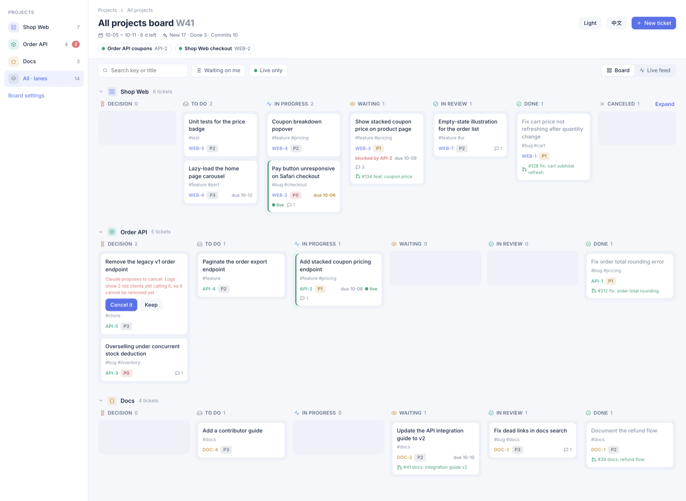
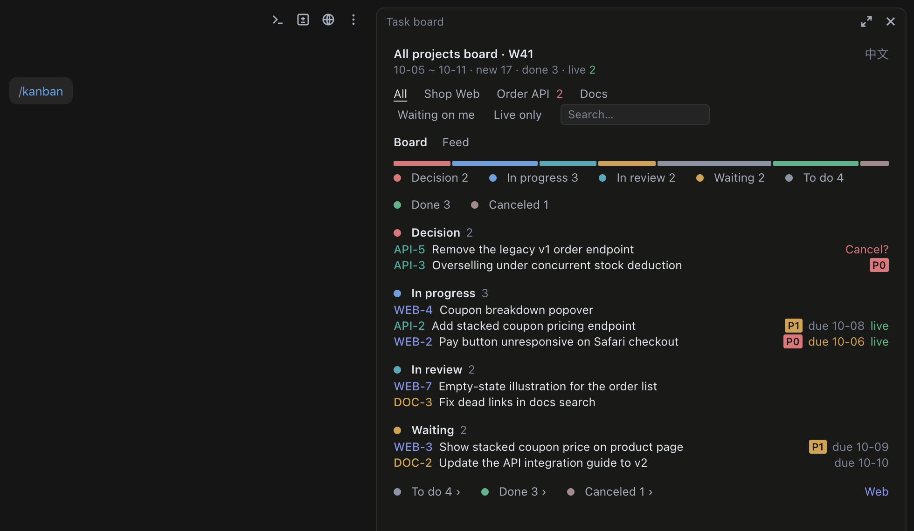
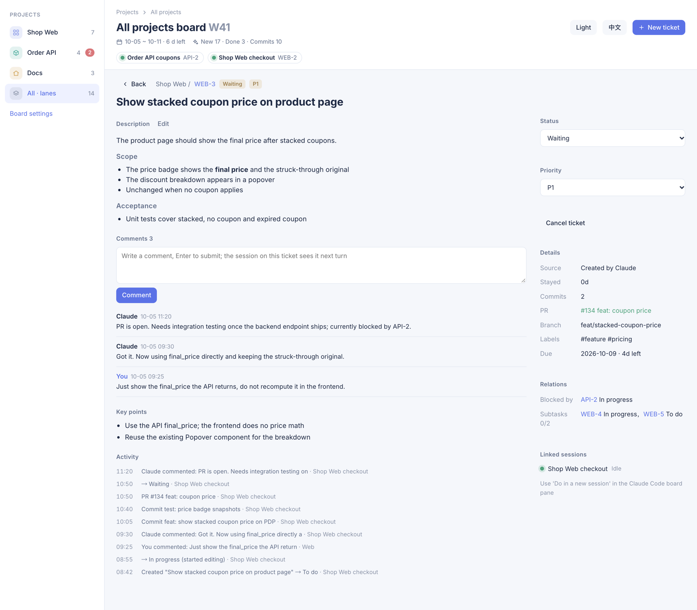

<p align="center">
  <strong>One Jira-style task board across all your Claude Code sessions</strong>
</p>
<p align="center">
  <a href="LICENSE"></a>
</p>
<p align="center">
  <strong>English</strong> · <a href="README.zh-CN.md">简体中文</a>
</p>

cc-taskboard lives in two places: a **local web page** where you see and manage every session and ticket at once, and a **board pane in the Claude Code sidebar**, so you can manage them any time without leaving the chat.

**On the web page** (`http://localhost:4790`): every project and session on one board; open a ticket, comment, accept, or start a new session for it.

<picture>
  <source media="(prefers-color-scheme: dark)" srcset="docs/images/board-dark-en.png">
  
</picture>

**In the Claude Code sidebar**: the same board next to every session; check, move and comment on tickets any time while you work.



## Install

In Claude Code, say:

```
Install cc-taskboard: read the steps with `gh api repos/DogShark129/cc-taskboard/contents/INSTALL.md -H "Accept: application/vnd.github.raw"` and follow them
```

When Claude asks you to type `/reload-plugins`, do so; it then offers to set up your boards.

Manual steps, updates, team setup and uninstall: [INSTALL.md](INSTALL.md).

## What it does

Every Claude Code session writes what it works on to a shared, local log, and every session shows the same board built from it. Claude files and moves tickets on its own: when it starts work, commits, opens or merges a PR, or asks you a question. You review, comment and accept; a comment wakes the session that owns the ticket.

## Workflow

1. **Set up your boards.** In any session, say:

   ```
   set up the task board
   ```

   Claude scans your recent sessions, proposes boards (one per project) and tickets, and writes nothing until you confirm.

2. **Just work.** Claude looks for an existing ticket before starting a piece of work, claims or creates one, and moves it as it goes. You rarely need to mention the board.

3. **Open the board** in any session:

   ```
   /kanban
   ```

   The pane docks in the sidebar; its "Web" link opens the web page.

4. **Review.** A finished ticket waits in In review. Click "Accept" to move it to Done, or write a comment to send it back: the comment wakes the session that owns the ticket, which handles it and replies.

   

5. **Start a ticket in a new session.** Click "New session" on the ticket, or drag it from To do to In progress. Claude prepares a session for it; the new session claims the ticket, and its title follows the ticket's status.

## What moves a ticket

| Event | Column |
|---|---|
| Claude edits a file while the ticket is in To do or Waiting | In progress |
| `git commit` | no move; the commit is recorded on the ticket |
| `gh pr create` | Waiting, with the PR number recorded |
| `gh pr merge` | In review |
| Claude asks you a question | Decision, then back where it was once you answer |
| Claude marks a ticket `done` | In review (Done only if you accepted it in the chat) |
| You click "Accept" / "Send back" | Done / In progress |
| Claude marks a ticket `canceled` (with a reason) | Decision, as a cancel proposal |
| You click "Cancel it" / "Keep" on a proposal | Canceled / the column it came from |
| You cancel a ticket, or drag it to Canceled | Canceled |
| You click "Restore" on a canceled ticket | the column it was in before |

The automatic moves apply to the session's current ticket. Details: [docs/usage.md](docs/usage.md#columns-and-the-review-gate).

## Features

- One board across all sessions: a pane in each session, plus a local web app on `127.0.0.1:4790`.
- A `ticket` tool for Claude (`mcp__cc-taskboard__ticket`): list, create, update, and an init wizard.
- Automatic status from `git commit`, `gh pr create`, `gh pr merge`, file edits and Claude's questions.
- A review gate: only you accept into Done or cancel; Claude can only propose a cancel, with a reason.
- Comments wake the session that owns the ticket.
- A new session per ticket; spawned sessions keep their title in sync with the ticket's status.
- Per-project boards matched by working directory, and read-only history weeks.
- English / Chinese UI (titles and descriptions stored in both); the theme follows the Claude desktop app or is fixed light / dark.

## Requirements

- Claude Code with function-hook plugins (built and tested on 2.1.286).
- macOS (tested). On Linux and WSL the board and the web app should work, without the desktop-app features (theme following, session titles, the init wizard's scan of recent sessions), which read the app's files under `~/Library/Application Support/Claude/`. Native Windows is not supported yet.
- Optional: [Deno](https://deno.com) 2.x for the web app; `git` and `gh` for the automatic status rules.
- Read access to the GitHub repository.

## Docs

- [INSTALL.md](INSTALL.md): install, updates, team setup, loading from a clone, uninstall, and [migrating from weekly-board](INSTALL.md#migrating-from-weekly-board).
- [docs/usage.md](docs/usage.md): the pane, the ticket tool, columns and the review gate, history weeks, language and theme, the web app, and the data files.
- [CONTRIBUTING.md](CONTRIBUTING.md): checks, development notes, and the protocol for editing from several sessions.

## Acknowledgements

Special thanks to [dashi-taskboard](https://github.com/chuspeeism/dashi-taskboard) by chuspeeism, a task board for Codex and DeepSeek Harness. Its idea of linking every task to the agent session that works on it, and of keeping the board as a panel of its own next to the sessions, inspired cc-taskboard. cc-taskboard shares no code with it.

## License

[MIT](LICENSE).
