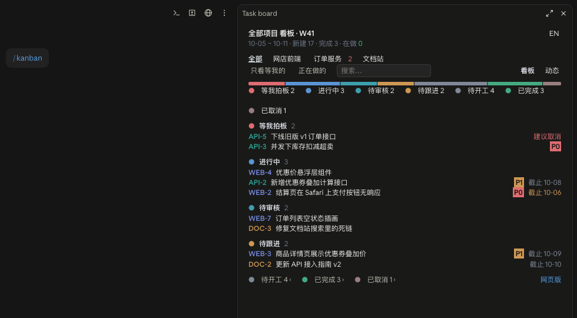
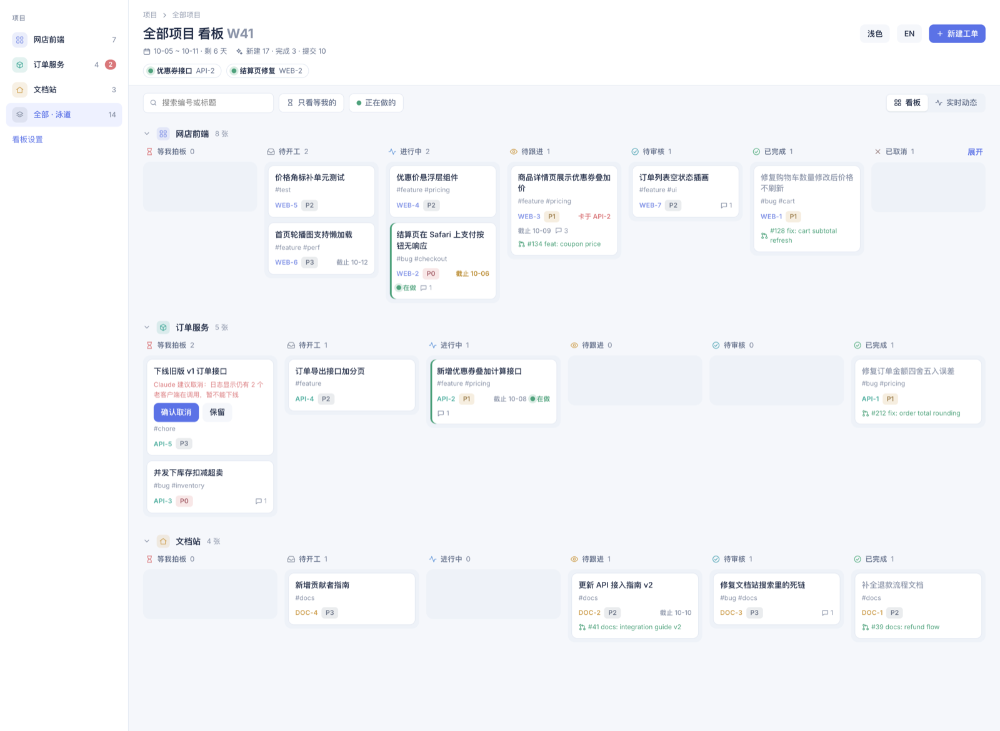
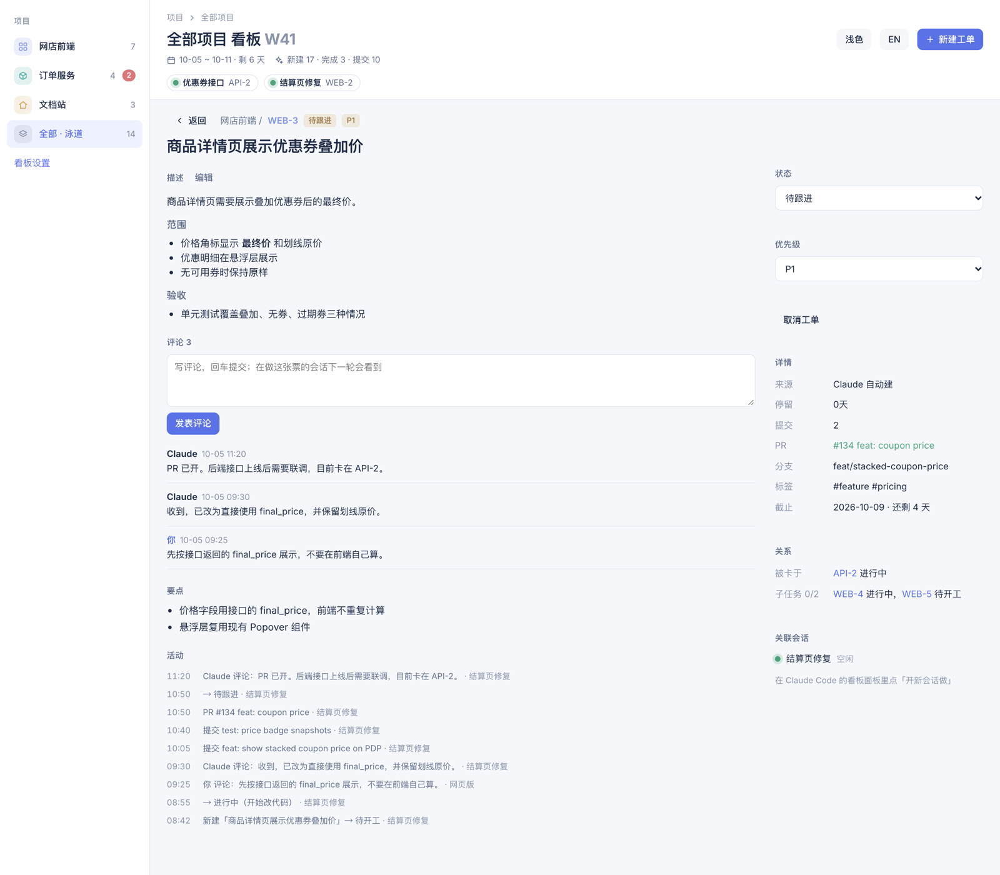

<p align="center">
  <strong>一块 Jira 风格的看板，管住你所有的 Claude Code 会话</strong>
</p>
<p align="center">
  <a href="LICENSE"></a>
</p>
<p align="center">
  <a href="README.md">English</a> · <strong>简体中文</strong>
</p>

cc-taskboard 用在两个地方：**Claude Code 侧边栏里的看板面板**，跟着每个会话；以及一个**本地网页**，在一处管理你所有的会话和工单。

**Claude Code 侧边栏**：当前项目的看板，就在对话旁边。



**网页**（`http://localhost:4790`）：所有项目、所有会话在一块看板上；打开工单、评论、验收，或为它开一个新会话。

<picture>
  <source media="(prefers-color-scheme: dark)" srcset="docs/images/board-dark-zh.png">
  
</picture>

## 安装

1. 打开函数钩子插件：在 `~/.claude/settings.json` 的 `env` 里加上 `"CLAUDE_CODE_ENABLE_FUNCTION_HOOKS": "1"`。
2. 在 Claude Code 里：

   ```
   /plugin marketplace add DogShark129/cc-taskboard
   /plugin install cc-taskboard@cc-taskboard
   ```

3. 重启 Claude Code，说一句「初始化看板」。

更新、团队配置、卸载：看 [INSTALL.zh-CN.md](INSTALL.zh-CN.md)。

## 它做什么

每个 Claude Code 会话都把自己在做的事写进一份共享的本地日志，所有会话看到的是同一块看板。Claude 会自己建票、挪票：开始干活、提交代码、开 PR、合并 PR、向你提问时都会更新。你负责审核、评论和验收；你留的评论会唤醒负责这张票的会话。

## 怎么用

1. **建看板。** 在任意会话里说：

   ```
   初始化看板
   ```

   Claude 会扫描你最近的会话，提出看板划分（每个项目一个）和工单，你确认之前什么都不写。

2. **照常干活。** Claude 开始做一件事之前会先查有没有现成的票，认领或新建一张，边做边挪。你基本不用提看板。

3. **打开看板**，在任意会话里输入：

   ```
   /kanban
   ```

   面板停靠在侧边栏；点「网页版」打开网页。

4. **审核。** 做完的票停在「待审核」。点「验收通过」移到已完成；或者写条评论把它打回：评论会唤醒负责这张票的会话，由它处理并回复。

   

5. **开新会话做一张票。** 在票上点「开新会话」，或把它从待开工拖到进行中。Claude 会为它准备一个新会话；新会话会认领这张票，标题跟着票的状态变。

## 什么会让票移动

| 发生了什么 | 票去哪一列 |
|---|---|
| 票在待开工或待跟进时，Claude 改了文件 | 进行中 |
| `git commit` | 不移动；提交记到票上 |
| `gh pr create` | 待跟进，并记下 PR 号 |
| `gh pr merge` | 待审核 |
| Claude 向你提问 | 等我拍板，你回答后回到原来的列 |
| Claude 把票标成 `done` | 待审核（只有你在对话里说了验收通过，才直接进已完成） |
| 你点「验收通过」/「打回」 | 已完成 / 进行中 |
| Claude 把票标成 `canceled`（必须带理由） | 等我拍板，作为「建议取消」 |
| 你在建议上点「确认取消」/「保留」 | 已取消 / 回到原来的列 |
| 你取消一张票，或把它拖到已取消 | 已取消 |
| 你在已取消的票上点「恢复」 | 回到取消前所在的列 |

自动移动只作用于会话当前的工单。详见 [docs/usage.zh-CN.md](docs/usage.zh-CN.md#列与审核关卡)。

## 功能

- 所有会话共用一块看板：每个会话里有一个面板，另有一个本地网页版（`127.0.0.1:4790`）。
- 给 Claude 的 `ticket` 工具（`mcp__cc-taskboard__ticket`）：list、create、update，以及初始化向导。
- 状态自动更新：来自 `git commit`、`gh pr create`、`gh pr merge`、改文件和 Claude 的提问。
- 审核关卡：只有你能验收进已完成、只有你能取消；Claude 只能带理由提议取消。
- 评论会唤醒负责这张票的会话。
- 一票一会话；看板开出来的会话标题跟着票的状态变。
- 按工作目录分项目看板，可以往回翻看历史周（只读）。
- 中英文界面（标题和描述两种语言都存）；主题跟随 Claude 桌面 app，也可以固定浅色或深色。

## 环境要求

- 支持 function-hook 插件的 Claude Code（在 2.1.286 上开发和测试）。
- 桌面 app 相关功能需要 macOS（主题跟随、会话标题、初始化向导扫描最近会话）：它们读 app 在 `~/Library/Application Support/Claude/` 下的文件。看板本身在别的系统上也能用。
- 可选：网页版需要 [Deno](https://deno.com) 2.x；自动状态规则用到 `git` 和 `gh`。
- 有这个 GitHub 仓库的读权限。

## 文档

- [INSTALL.zh-CN.md](INSTALL.zh-CN.md)：安装、更新、团队使用、从克隆加载、卸载，以及[从 weekly-board 迁移](INSTALL.zh-CN.md#从-weekly-board-迁移)。
- [docs/usage.zh-CN.md](docs/usage.zh-CN.md)：面板、ticket 工具、列与审核关卡、历史周、语言与主题、网页版和数据文件。
- [CONTRIBUTING.zh-CN.md](CONTRIBUTING.zh-CN.md)：检查命令、开发说明，以及多会话同时修改的协议。

## 特别感谢

特别感谢 chuspeeism 的 [dashi-taskboard](https://github.com/chuspeeism/dashi-taskboard)，一个支持 Codex 和 DeepSeek Harness 的任务面板。它把每个任务和处理它的 agent 会话关联起来、让看板作为独立面板放在会话旁边的思路，启发了 cc-taskboard。cc-taskboard 没有使用它的代码。

## 许可证

[MIT](LICENSE)。
