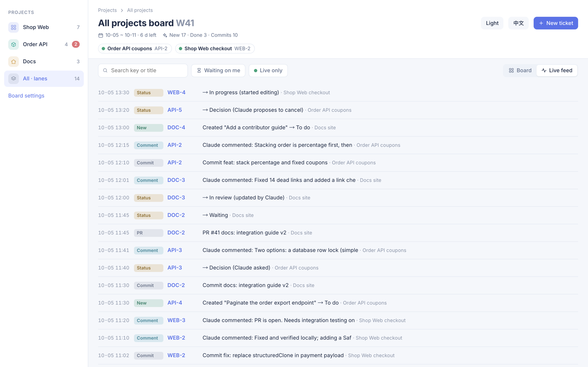

# Usage

English · [简体中文](usage.zh-CN.md)

## The pane

The board docks itself in the session's pane sidebar on your first prompt. If you close it, it stays closed for that session; `/kanban` or `/taskboard` opens it again.

- Header: the board title and ISO week, the date range, days left in the week, and this week's counts (new, done, commits). Week navigation (previous / next / this week), a link to the web app, the theme button (Follow Claude / Light / Dark) and the language button (EN / 中文).
- Project tabs: one per board, with a red count of tickets waiting for your decision, plus "All", which shows every board as a lane.
- Filters: "Waiting on me" (the Decision column only) and "Live only" (tickets a session is working on right now); a search box for key, title or label; "Board" / "Feed" (the live activity feed).
- A "Working:" line lists the sessions that are busy and the ticket each is on.
- Cards show the title, key, priority, labels, blockers, due date, a "live" mark while a session works on the ticket, days in the current column (red after 7), the comment count and the PR.

## The ticket tool

Claude calls `mcp__cc-taskboard__ticket` with an `action`:

- `list`: open tickets, optionally filtered by `q` (key, title, labels).
- `create`: a new ticket. Takes `title` and `title_en` (both languages), and optionally `col`, `desc` / `desc_en`, `priority` (P0 to P3), `labels`, `due` (YYYY-MM-DD), `blockedBy`, `parent`, `note`, `comment`, `project`. `src: "me"` marks tickets you asked for ("add this to the board").
- `update`: change any of the above on `key`; `work: true` claims the ticket for the current session.
- `init`: the setup wizard. Without a plan it returns the scan; with a `plan` it returns a preview; with the same `plan` and `confirm: true` it writes.

Claude is told to look for an existing ticket before starting a piece of work, and to claim or create one. The tool's own description carries the rules, so you rarely need to mention it.

## Columns and the review gate

Decision (waiting for you), To do, In progress, Waiting (on others: PR review, a reply), In review, Done, and Canceled (shown only when it holds a ticket, and as a drop target while you drag a card).

Automatic moves for the session's current ticket:

- Claude edits a file while the ticket is in To do or Waiting: In progress.
- `gh pr create`: Waiting, with the PR number recorded. `git commit` records the commit on the ticket.
- `gh pr merge`: In review.
- Claude asks you a question: Decision, and back to where it was once you answer.

Claude can move a ticket to In review at most. A `done` from Claude lands in In review, unless you said in the chat that you accept it (the tool's `userAccepted`). On the board, "Accept" moves it to Done and "Send back" returns it to In progress.

Canceling works the same way. A `canceled` from Claude lands in Decision as a proposal and needs a reason (`comment` or `note`); the card, the preview and the detail then offer "Cancel it" and "Keep" (back to the column it came from). Claude cancels directly only when you said so in the chat (`userAccepted`). You can cancel any ticket from its preview or detail ("Cancel ticket", with an optional reason in the detail and on the web), or by dragging it to Canceled; the feed shows who canceled what and why. "Restore" on a canceled ticket returns it to the column it was in before.

In the pane, To do, Done and Canceled sit folded below the list; on the web board Done and Canceled fold behind an "Expand" toggle. Done and canceled tickets from earlier weeks are archived off the current board; a search still finds archived canceled ones.

## Pane, preview and detail

The pane is a focus list: Decision, In progress, In review and Waiting as sections of one-line rows, a status ribbon whose legend hides or shows a status, and To do, Done and Canceled folded below. Click anywhere on a row for a preview under it (the row again closes it; on mobile, the title): status and priority pickers, "Open details", "New session", "Go to session", cancel or restore, the description, the latest comments and a comment box. On the web board, drag a card to another column to move it; clicking a card opens a popup with everything the detail view has. The detail view has status and priority pickers, labels and due date fields (pane only), relations (parent, subtasks, blocked by, blocks), linked sessions (each with "Switch to it"), "New session", the description editor, comments, key points and the activity log. On the web, "New session" and "Switch to it" open the desktop app through its `claude://` links, the same ones the pane opens.


## Comments wake the owning session

A comment you write on the board (pane, preview or web app) goes to the session that owns the ticket: the live session working on it, else the most recently seen live session that worked on it. That session gets the comment as a prompt as soon as it is idle, handles it, replies with a comment and moves the ticket to In review. Each comment is delivered once, by one session.

## A new session per ticket

"Do in a new session" in the detail view, or dragging a ticket from To do to In progress (when no session is already working on it), asks Claude in the current session to prepare a new session for that ticket with the desktop app's `spawn_task`. That leaves a chip in the conversation; you click it to open the session. It takes one click because a plugin cannot open a session itself: only Claude can call the app's session tools, and `spawn_task` offers a session rather than starting one, so you stay in control of what opens. The new session's first prompt claims the ticket and has it investigate the code and propose a plan, which it asks you to approve before changing anything (the ticket waits in Decision meanwhile). Its title follows the ticket's status (for example `【Oct 3 - in progress】APP-3 Login page`).

For a ticket you start from the web app, one live session (the ticket's owner, else the most recently active one) prepares the chip.

Other buttons in the detail view: "Continue in this session", "Ask <session> for progress" (sends a message to the session working on it) and "Verify actual state" (Claude checks commits, branches and PRs and updates the ticket).

## History weeks

Use the previous / next week buttons to see the board as it stood at the end of an earlier week. Past weeks are read-only.

## Language and theme

The language button switches the UI between English and Chinese; the choice is remembered. Ticket titles and descriptions are stored in both languages (Claude fills in the missing side). Prompts and tool text sent to Claude stay in Chinese.

The theme button cycles Follow Claude, Light and Dark. Follow Claude reads the desktop app's theme setting (`userThemeMode` in its `config.json`) and, when that is "system", the macOS appearance.

## The web app

`/kanban-web` starts the local web app if it is not running and replies with its address, `http://127.0.0.1:4790` (the header's web link opens `http://localhost:4790`). Every session also starts it at session start when nothing answers on that port. It shows the same board and lets you create tickets, drag, comment, edit descriptions and priorities, and accept or send back. It binds to 127.0.0.1 only and refuses cross-site writes.

To run it by hand from the repository:

```sh
deno run --allow-read --allow-write --allow-env --allow-net=127.0.0.1 --allow-run=claude,defaults web/server.ts
```

Stop it with `pkill -f cc-taskboard/web/server.ts`. Restart it after changing `hooks/core.ts`. `WB_PORT` sets another port for a manual run; the plugin always uses 4790.



## Data

Everything is local; nothing leaves your machine. The data directory is `~/.claude/cc-taskboard/`, or the path in the environment variable `CC_TASKBOARD_DATA` (read by both the plugin and the web app):

- `events/<session-id>.jsonl`: one append-only event log per session; `events/web.jsonl` holds the web app's writes, `events/init-<date>.jsonl` one init wizard run.
- `sessions/<session-id>.json`: each session's state (current ticket, busy / idle, last seen).
- `projects.json`: the boards. A list of `{ "id": "APP", "name": "...", "name_en": "...", "match": "<regex on the session's cwd>", "root": "<default repo path>", "color": "#8394e6", "icon": "grid" }`; `id` is the ticket key prefix, the first board whose `match` fits a session's working directory owns it. Leave `id` out and the board gets a default prefix (its English name's initials, e.g. Board Dev → BD; a one-word name gives its first three letters), written back to the file. The init wizard writes this file; you can edit it by hand, or change every board's prefix and names on the web app's **Board settings** page: a new prefix rekeys that board's tickets with their numbers kept (WB-12 → KB-12), and the old keys still find them. Changing back to an earlier prefix is fine.
- `spawned.json`: sessions the board opened (their titles follow their ticket).
- `web.log`: the web app's output.

Back up: copy the directory. Reset: stop the web app, then move or delete the directory; the next session starts empty. To undo one init wizard run, delete its `events/init-<date>.jsonl`.
