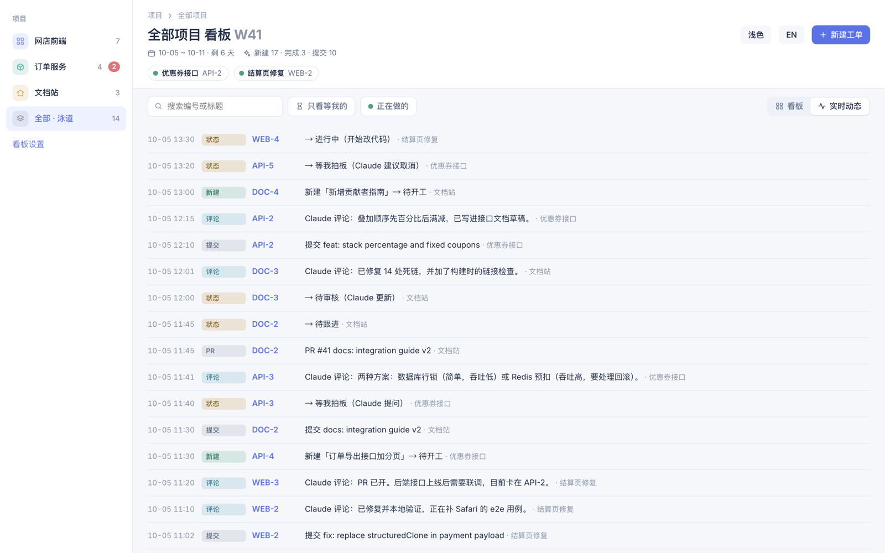

# 使用说明

[English](usage.md) · 简体中文

## 面板

看板会在你发出第一条消息时停靠到会话的面板侧栏。你手动关掉后，本会话内不再自动打开；`/kanban` 或 `/taskboard` 可以重新打开。

- 标题区：看板标题和 ISO 周数、日期范围、本周剩余天数、本周统计（新建、完成、提交）。周导航（上一周 / 下一周 / 回到本周）、网页版链接、主题按钮（跟随 Claude / 浅色 / 深色）和语言按钮（EN / 中文）。
- 项目页签：每个 board 一个，红色数字是等你拍板的工单数；另有「全部」，把所有 board 按泳道显示。
- 筛选：「只看等我的」（只看「等我拍板」列）和「正在做的」（有会话正在做的工单）；搜索框（编号、标题、标签）；「看板」/「动态」（实时动态流）。
- 「在做：」一行列出正忙的会话和各自在做的工单。
- 卡片显示标题、编号、优先级、标签、阻塞、截止日期、有会话在做时的「在做」标记、在当前列停留的天数（超过 7 天变红）、评论数和 PR。

## ticket 工具

Claude 调用 `mcp__cc-taskboard__ticket`，带一个 `action`：

- `list`：未完成的工单，可用 `q` 过滤（编号、标题、标签）。
- `create`：新建工单。要 `title` 和 `title_en`（两种语言），可选 `col`、`desc` / `desc_en`、`priority`（P0 到 P3）、`labels`、`due`（YYYY-MM-DD）、`blockedBy`、`parent`、`note`、`comment`、`project`。`src: "me"` 表示是你要求加的（「加到看板」）。
- `update`：修改 `key` 指定工单的上述字段；`work: true` 表示本会话认领这张票。
- `init`：初始化向导。不带 plan 返回扫描结果；带 `plan` 返回预览；带同一个 `plan` 加 `confirm: true` 才写入。

Claude 会被告知：开始一件具体的事之前先查有没有现成的票，再认领或新建。规则写在工具说明里，你一般不用提它。

## 列与审核关卡

等我拍板、待开工、进行中、待跟进（等别人：PR 评审、对方回复）、待审核、已完成，以及已取消（只在有票时显示；拖拽卡片时也作为放置目标出现）。

对会话当前工单的自动移动：

- 工单在待开工或待跟进时 Claude 改了文件：进行中。
- `gh pr create`：待跟进，并记下 PR 号。`git commit` 会把提交记到工单上。
- `gh pr merge`：待审核。
- Claude 向你提问：等我拍板，你回答后回到原来的列。

Claude 最多只能把票移到待审核。Claude 传 `done` 会落到待审核，除非你在对话里明确说验收通过（工具的 `userAccepted`）。在看板上，「验收通过」移到已完成，「打回」退回进行中。

取消也一样。Claude 传 `canceled` 会落到等我拍板，成为「建议取消」，而且必须带理由（`comment` 或 `note`）；卡片、预览和详情上会出现「确认取消」和「保留」（回到原来的列）。只有你在对话里明确说取消时（`userAccepted`），Claude 才能直接取消。任何工单你都可以在预览或详情里「取消工单」（详情和网页版可以选填理由），或拖到已取消；动态流会显示谁取消了什么、为什么。已取消的工单可以「恢复」，回到取消前所在的列。

面板里，待开工、已完成和已取消收起在清单下方；网页版的已完成和已取消收起在「展开」按钮后面。之前各周已完成和已取消的票会从当前看板归档；搜索仍能找到已归档的已取消工单。

## 面板、预览与详情

面板是一份清单：等我拍板、进行中、待审核、待跟进分节列出，一票一行；上面一条状态条，点图例可以隐藏或显示某个状态；待开工、已完成和已取消收起在下方。点一行的任意位置，预览展开在这一行下面（再点一次收起；手机上点标题）：状态和优先级选择、「打开详情」、「开新会话」、「跳到会话」、取消或恢复、描述、最近评论和评论框。网页版里把卡片拖到另一列即可移动；点卡片弹出的预览包含详情页的全部内容。详情页有状态和优先级选择、标签和截止日期输入（仅面板）、关系（父任务、子任务、被卡于、卡着）、关联会话（每个都有「切过去」）、「开新会话」、描述编辑、评论、要点和活动记录。网页上的「开新会话」和「切过去」通过桌面 app 的 `claude://` 链接打开，和面板用的是同一套链接。


## 评论唤醒负责的会话

你在看板上（面板、预览或网页版）写的评论会送到负责这张票的会话：正在做它的 live 会话，否则是最近活跃过、做过它的 live 会话。那个会话一空闲就会收到这条评论作为一条提示，处理后用评论回复，并把票移到待审核。每条评论只投递一次，只由一个会话处理。

## 一票一会话

详情页的「开新会话做」，或把票从待开工拖到进行中（且还没有会话在做它），会让当前会话的 Claude 用桌面 app 的 `spawn_task` 为这张票准备一个新会话。对话里会出现一张卡片，你点一下才打开那个会话。之所以要点一下：插件自己不能开会话，只有 Claude 能调用 app 的会话工具，而 `spawn_task` 只是提供一个会话入口、不会直接启动，所以开什么由你决定。新会话的第一句提示会认领这张票，它的标题会跟着票的状态变（例如 `【Oct 3 - in progress】APP-3 登录页改版`）。

在网页版上开工的票，由一个 live 会话（票的负责会话，否则是最近活跃的那个）来准备这张卡片。

详情页的其他按钮：「在本会话继续」、「问 <会话> 进度」（给正在做的会话发消息）和「核对实际状态」（Claude 核对提交、分支和 PR 后更新工单）。

## 历史周

用上一周 / 下一周按钮查看某一周结束时的看板。历史周只读。

## 语言与主题

语言按钮在中文和英文界面之间切换，选择会被记住。工单标题和描述两种语言都存（缺的一边由 Claude 补齐）。发给 Claude 的提示和工具说明保持中文。

主题按钮在跟随 Claude、浅色、深色之间循环。跟随 Claude 读桌面 app 的主题设置（其 `config.json` 里的 `userThemeMode`），设置为 system 时看 macOS 的外观。

## 网页版

`/kanban-web` 会在网页版没运行时启动它，并回复地址 `http://127.0.0.1:4790`（标题区的网页版链接打开 `http://localhost:4790`）。每个会话启动时，如果这个端口没有响应，也会自动启动它。网页版显示同一块看板，可以新建工单、拖拽、评论、改描述和优先级、验收或打回。它只监听 127.0.0.1，并拒绝跨站写入。

在仓库里手动运行：

```sh
deno run --allow-read --allow-write --allow-env --allow-net=127.0.0.1 --allow-run=claude,defaults web/server.ts
```

停止：`pkill -f cc-taskboard/web/server.ts`。改了 `hooks/core.ts` 之后要重启它。`WB_PORT` 可以给手动运行换端口；插件始终用 4790。



## 数据

一切都在本地，不会离开你的电脑。数据目录是 `~/.claude/cc-taskboard/`，或环境变量 `CC_TASKBOARD_DATA` 指定的路径（插件和网页版都读它）：

- `events/<会话 id>.jsonl`：每个会话一份只追加的事件日志；`events/web.jsonl` 是网页版的写入，`events/init-<日期>.jsonl` 是一次初始化向导的写入。
- `sessions/<会话 id>.json`：每个会话的状态（当前工单、忙 / 闲、最后活跃时间）。
- `projects.json`：board 配置。一个列表，每项形如 `{ "id": "APP", "name": "...", "name_en": "...", "match": "<匹配会话 cwd 的正则>", "root": "<默认仓库路径>", "color": "#8394e6", "icon": "grid" }`；`id` 是工单编号前缀，第一个 `match` 命中会话工作目录的 board 拥有该会话。不写 `id` 时自动给一个默认前缀（取英文名首字母，如 Board Dev → BD；名字只有一个词时取前三个字母），并写回文件。初始化向导会写这个文件，你也可以手改，或者在 web 版的**看板设置**页统一改所有看板的前缀和名称：改了前缀，这个看板的票会一起改编号、数字不变（WB-12 → KB-12），用旧编号还能找到；也可以改回以前的前缀。
- `spawned.json`：看板开出来的会话（它们的标题跟着工单走）。
- `web.log`：网页版的输出。

备份：复制整个目录。重置：先停网页版，再移走或删除这个目录，下一个会话从空看板开始。撤销某一次初始化向导：删掉它的 `events/init-<日期>.jsonl`。
